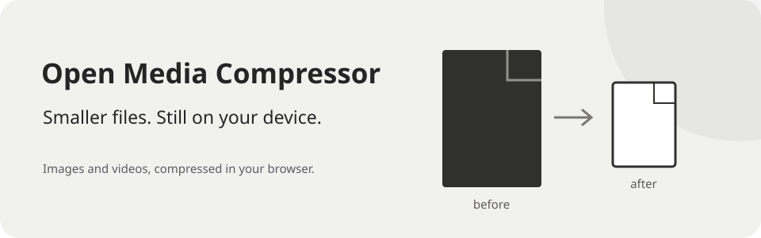

# Open Media Compressor

**Smaller files. Still on your device.**



Drop in an image or video. Choose a maximum size. Download the result.
Compression runs in your browser. Your media is not uploaded to a server.

[**Open the compressor →**](https://open-media-compressor.nickdrezza.com)

## Pick a size. Keep it local.

1. Select or drop your media files.
2. Set **Max Size** in KB or MB.
3. Compress and download the result.

| Input | Output |
| --- | --- |
| Supported video | H.264/AAC MP4. Silent video stays silent. |
| Supported still image | JPEG. Resolution is kept when possible. |
| Animated image | A still JPEG frame, not an animation. |

Image transparency is flattened onto white. The app reduces image quality before dimensions.
Video output is checked against the requested size, with media metadata and chapters removed.

## Browser support

The app uses browser codecs when they can encode the requested tracks.
If that path is unavailable or fails, it retries with FFmpeg WebAssembly.
All media processing stays on your device.

Results depend on browser codec support and available memory.
HEIC, HDR, camera formats, iOS, and Safari support are not guaranteed.
The desktop WebKit test is a compatibility check, not proof of iOS or Safari support.

## Run locally

Use Node 22.23.1, the CI runtime. Install dependencies and start Vite:

```sh
git clone https://github.com/nickdrezza/open-media-compressor.git
cd open-media-compressor
npm ci
npm run dev
```

Build for production with `npm run build`.

<details>
<summary>Development checks and codecs</summary>

The video path uses Mediabunny and WebCodecs, with `ffmpeg.wasm` for compatibility.
Canvas provides common image decoding and JPEG encoding. FFmpeg also handles TIFF and
fallback decoding. The interface uses Alpine.js and CSS; Vite builds the app.

Run the unit suite and Chromium browser suites:

```sh
npm test
npx playwright install chromium
npm run test:e2e:dev
npm run test:e2e:built
```

The browser suite checks that no media upload POST or PUT requests occur.
Run the optional desktop WebKit suite when that browser is installed:

```sh
npx playwright install webkit
npm run test:e2e:webkit
```

Regenerate the deterministic test fixtures only when their generator changes:

```sh
npm run fixtures:generate
```

</details>

Made by [nickdrezza](https://nickdrezza.com).

## License

This project is licensed under [GNU AGPLv3 only](LICENSE) (`AGPL-3.0-only`).
See [NOTICE](NOTICE) for copyright information.

You can use, change, and sell copies under the license terms.
If you distribute covered code, provide its source under the same license.
If you change the project and let users access it over a network,
offer those users the source of your version.

Earlier releases keep the license terms that applied to them.
